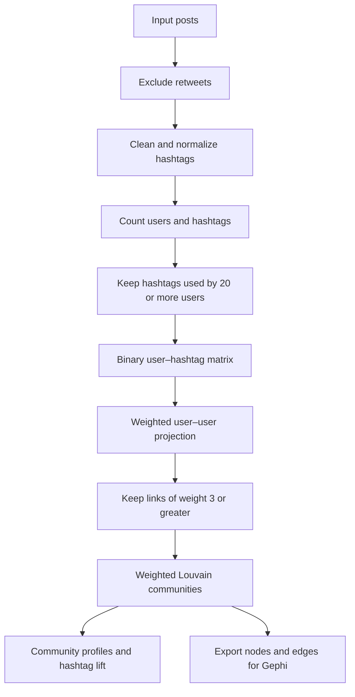

<div align="center">

# Astesiano case: Hashtag Communities on X

### A reproducible network analysis of the Astesiano case in Uruguay

**Social network analysis · Folksonomies · Community detection · R**

[](https://www.r-project.org/)
[](https://r.igraph.org/)
[](https://igraph.org/)
[](#research-context)

*How do shared hashtags connect users, and what distinguishes the communities that emerge?*

</div>

---

## Overview

This repository documents a reproducible workflow for investigating **user communities associated with hashtag use on X (formerly Twitter)** during public discussion of the **Astesiano case in Uruguay**.

The analysis starts with posts and their hashtags, constructs a binary **user–hashtag matrix**, and projects it into a weighted **user–user network**. Links represent the number of *distinct hashtags shared* by a pair of users. Communities are identified with the **Louvain algorithm**, and their hashtag repertoires are described using frequency and **lift**.

The research focuses on the structure of shared labeling practices. A shared hashtag is treated as evidence of common use of a label, **not** as proof that users agree with each other or assign the same meaning to that label.

## At a glance

| Analytical choice | Implementation |
|:--|:--|
| Unit used to construct links | Users connected through distinct hashtags used by both |
| Hashtag inclusion threshold | **≥ 20 distinct users per hashtag** |
| Hashtags retained in the thesis corpus | **30** |
| User–user edge weight | Number of distinct hashtags shared |
| Network retained for community detection | **Edge weight ≥ 3**, removing isolates |
| Community detection | **Weighted Louvain**, `set.seed(123)` |
| Community-level hashtag characterization | **Lift > 1** and **≥ 5 users** within the community |

> **Reading the thresholds:** the *20-user* criterion selects hashtags for the network. The *3-hashtag* criterion filters user–user links. The *5-user* criterion applies later when describing hashtags within communities. These are separate decisions.

## Analytical workflow



**Lift** compares the proportion of users using a hashtag *inside one community* against the corresponding proportion *across the filtered network*:

\[
\mathrm{lift}(h,c) =
\frac{\#\text{ users in community }c\text{ using }h\;/\;\#\text{ users in }c}
{\#\text{ users in filtered network using }h\;/\;\#\text{ users in filtered network}}
\]

A lift above 1 indicates **relative overrepresentation**, not necessarily high absolute frequency. To avoid relying on very small counts, the representative-hashtag table also requires at least **five distinct users within the community**. The script additionally produces a *top-five-by-lift* table; this is a summary, not the full set of qualifying hashtags.

## Repository structure

```text
.
├── main.R                      # Run the complete pipeline
├── R/
│   ├── 01_preparacion_datos.R   # Input, filtering, normalization
│   ├── 02_frecuencias.R        # Frequencies and hashtag thresholds
│   ├── 03_matrices_y_grafos.R  # Binary matrix and weighted network
│   ├── 04_louvain.R            # Communities and node measures
│   ├── 05_analisis_hashtags.R  # Community profiles and lift
│   └── 06_exportacion_gephi.R  # Export nodes and edges
├── data/
│   └── README.md               # Input requirements and access notes
├── .gitignore                  # Excludes local research data files
└── README.md
```

## Reproduce the analysis

### Requirements

- R and the packages **`tidyverse`**, **`stringi`**, and **`igraph`**.
- Authorized access to a compatible dataset saved as an `.RData` file containing an object named **`Data`**.
- Run commands from the repository root (for example, from an RStudio Project opened there).

Install the required packages if necessary:

```r
install.packages(c("tidyverse", "stringi", "igraph"))
```

The input must include the columns `id`, `author.username`, `entities.hashtags`, and `referenced_tweets.retweeted.id`. See [data/README.md](data/README.md) for details.

**Option A — keep the dataset outside the repository (recommended):**

```r
Sys.setenv(ASTESIANO_DATA_PATH = "C:/your/private/path/dados01.RData")
source("main.R", encoding = "UTF-8")
```

**Option B — store it locally in the ignored `data/` directory:**

```text
data/dados01.RData
```

Then run:

```r
source("main.R", encoding = "UTF-8")
```

The code expects the input to have the same structure as the research dataset; supplying an arbitrary `.RData` file is not sufficient. For a clean reproducibility check, start a fresh R session before running `main.R`.

### Quick checks

```r
nrow(frecuencia_total_hashtags_recorte) # 30 in the thesis dataset
vcount(g_peso_3)                     # Inspect retained network size
sizes(comunidades_louvain_peso3)      # Community sizes
head(hashtags_representativos)        # Lift > 1; >= 5 users per community
```

The scripts generate network exports in the **current working directory**:

- `nodos_usuario_usuario_peso3_comunidades.csv`
- `aristas_usuario_usuario_peso3.csv`

These files contain user identifiers; **review them before sharing or uploading**. They are not automatically safe to publish simply because they are derived data.

## Interpretation and limitations

- **Shared hashtag use does not establish ideological agreement or semantic equivalence.** Qualitative interpretation requires additional examination of the posts and their context.
- **Thresholds shape the observed network.** Results depend on the inclusion rule and the filtering of weak ties.
- **Projection transforms the data.** A user–user edge summarizes overlap in hashtags, rather than direct interaction between users.
- **Community assignments are algorithmic results.** Their substantive meaning requires interpretation and validation; membership labels are not fixed identities.

## Data availability and research ethics

The original X dataset is **not publicly distributed** in this repository because of access conditions and privacy considerations. The source code is shared separately from the data. Consult [the data documentation](data/README.md) before attempting reproduction or redistribution.

## Research context

This project forms part of a master's thesis in **Information and Communication** at the **Universidad de la República (Uruguay)**, examining folksonomies and communities of users around the Astesiano case. It illustrates how network methods can support the study of social indexing practices.

**Researcher:** [Andrés Abdala](https://github.com/AndresAb00)

## How to cite

If you use this workflow, please cite this repository and the associated academic publication or thesis **when its full bibliographic information is available**. A versioned release and `CITATION.cff` file can be added once the citation details are finalized.
## Network Visualizations

### User communities detected with Louvain


---

<div align="center">

</div>
